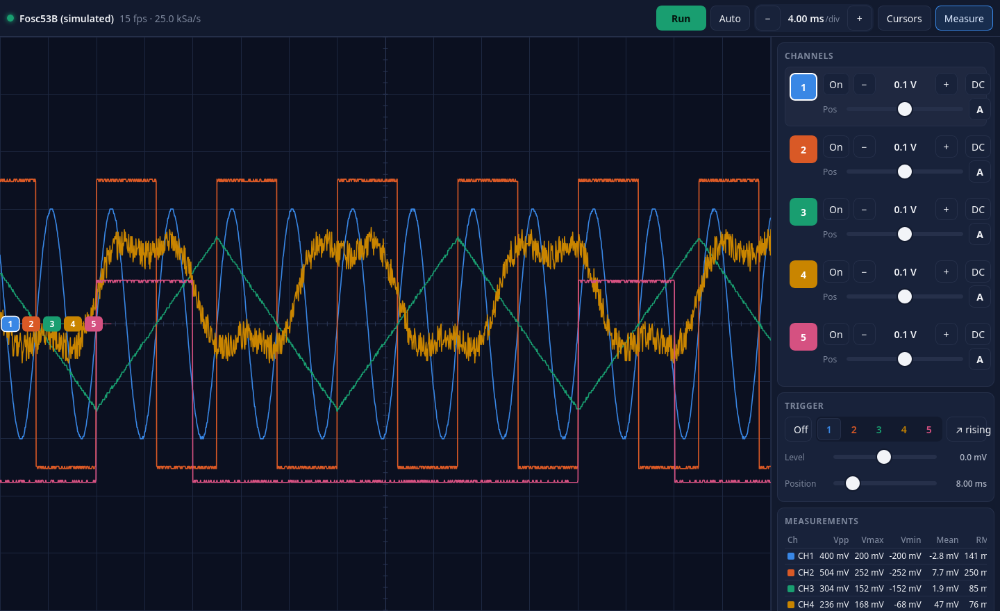
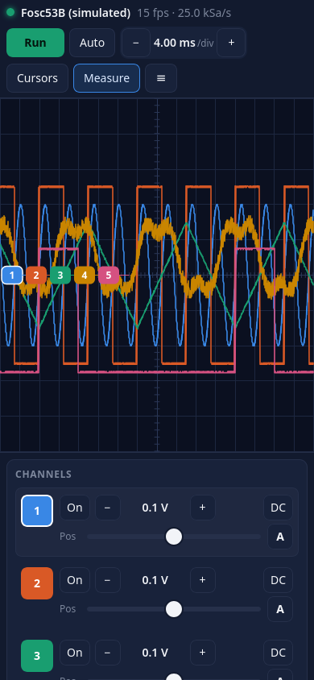

# fosc53b-web-bridge

A self-hosted web UI for the **Fosc53B** 5-channel Wi-Fi oscilloscope (focussz.com),
built on a reverse-engineered implementation of its network protocol. A small Python
bridge holds the scope's single allowed connection and streams the waveforms to any
number of browsers on the LAN, so the same live view works on a PC, phones and tablets
at once, with no vendor app.

```
  Fosc53B  ──Wi-Fi/LAN──▶  server.py (bridge, port 8053)  ──WebSocket──▶  browsers
```



## Hardware

* **Fosc53B** 5-channel Wi-Fi oscilloscope. Internally an ESP8266 serial-to-Wi-Fi bridge sits in front of the scope MCU.
* The scope must be on the same LAN (or you connect the PC to its access point).
  UDP discovery uses port 8991; data and control use TCP 8992/8993.
* Tested with one unit; other firmware revisions may differ.

## Requirements and install

Python 3.10+ and the `websockets` package (>= 13). Nothing else.

```bash
# on Fedora
sudo dnf install python3-websockets
# elsewhere
pip install websockets

git clone https://github.com/Bulrok/fosc53b-web-bridge.git
cd fosc53b-web-bridge
python3 server.py
```

Then open <http://localhost:8053/>, or the LAN URL the server prints (also shown in the
page's *Device* card) on a phone that is on the same network.

Options: `--port 8053`, `--ip SCOPE_IP` (skip UDP discovery), `--settings FILE`
(where the shared scope settings are persisted, default `settings.json` next to
`server.py`), `--sim` (no hardware: five synthetic test signals, for working on the UI
or demoing it), `-v`.

To run it permanently as a systemd user service, edit the `ExecStart` path in
`fosc53b.service` to point at your checkout, then:

```bash
mkdir -p ~/.config/systemd/user && cp fosc53b.service ~/.config/systemd/user/
systemctl --user daemon-reload && systemctl --user enable --now fosc53b
```

The scope allows exactly one client. Close the vendor Windows/Android app before
starting the bridge; while another app is connected the page shows "busy".

## Kiosk tablet (optional)

An Android tablet makes a good dedicated bench display: run the same page in
[Fully Kiosk Browser](https://www.fully-kiosk.com/) pointed at the bridge, fullscreen,
screen kept on. The page has a touch layout (bigger targets, wider panel, larger channel
tags) that switches on automatically for coarse pointers. There is deliberately no native
app: the scope accepts one client, so anything on the tablet that spoke to it directly
would lock the PC out, and a WebView wrapper would add nothing over Fully.

To configure Fully from a PC over ADB, copy `tablet/fully-once-settings.example.json`
to `tablet/fully-once-settings.json` (gitignored), replace `BRIDGE_IP` with the bridge
machine's LAN address, push it into Fully's folder and restart the app; the file is
imported once and deleted:

```bash
adb push tablet/fully-once-settings.json /sdcard/Android/data/de.ozerov.fully/files/
adb shell am force-stop de.ozerov.fully
adb shell am start -n de.ozerov.fully/.MainActivity
```

Give the bridge machine a DHCP reservation so the address stays valid. Fully's own menu
is a swipe from the left edge (hold briefly first); it is not locked down.

## Using the page



* **Run / Stop** freezes the display per viewer. While stopped, drag horizontally to
  scroll back through history (about 40 s at the fastest timebases, hours at slow
  ones), use **−/+** or pinch/wheel to zoom the time axis, double-tap to jump back to
  the newest data.
* **−/+** while running changes the scope's time base (100 µs/div … 4 s/div).
* **Auto** (key A) sets every enabled channel's V/div and position so the trace spans
  about 6 divisions centred on screen, picks a time base showing ~4 periods of the fastest
  channel and puts a rising-edge trigger at its mid level. The scope applies V/div in
  hardware with about a second of latency, so Auto checks fresh samples and refines up to
  5 times (the hint shows the pass). Tap again to cancel. The **A** button on a channel row
  does only that channel's vertical scale and position.
* **Channels**: tap the number to select it, *On/Off*, *−/+* volts per division
  (1 mV … 1 V/div as reported by the scope), *DC/AC* coupling, *Pos* moves the
  trace. You can also drag the numbered tag at the left edge of the screen.
* **Trigger**: on/off, source channel, edge, level (shown in volts of the source
  channel) and horizontal position. The scope triggers in hardware; the page also
  aligns the frames it receives so the display stays stable.
* **Cursors**: two time cursors and two voltage cursors, draggable; the readout
  shows Δt, 1/Δt, the voltage at each cursor for every channel, and ΔV for the
  selected channel.
* **Measurements**: Vpp, Vmax, Vmin, mean, AC RMS and frequency of every enabled
  channel over the visible window.
* **Export CSV / Save PNG** of what is on screen. **Fullscreen** for kiosk use.
* Keyboard: Space run/stop, ←/→ time base, 1–5 select channel (Shift+number toggles
  it), ↑/↓ move the selected channel, C cursors, M measurements.

Settings (time base, channels, trigger) are shared by all viewers because there is
one scope; run/stop, zoom, cursors and measurements are per viewer.

## How it talks to the scope (reverse engineered)

The unit is an ESP8266 serial-to-Wi-Fi bridge in front of the scope MCU. Everything
below was recovered from the vendor Android app (`FoscV2.apk`) and verified live;
see `fosc.py` for the implementation.

* **Discovery** – UDP broadcast to port 8991, 28-byte request
  `head 0x20180205, len, my IP, my port, "FindDev\0", CRC32` (poly 0xEDB88320,
  seed 0x5A5A5A5A, no final xor). The reply (112 bytes) carries IP, MAC, data port
  (8992), control port (8993), a "connected" flag, model and name.
* **Control port** – the same framed packets: a 32-byte serial config (2 000 000
  baud, 8N1, GPIO word) and a 20-byte heartbeat every second. GPIO word 9/11 toggles
  a DTR-like line that is pulsed for ~1 s whenever the scope settings change.
* **Data port** – raw serial to the MCU. Handshake: `FF 05 + 4-byte challenge`
  (a CRC-derived nonce with 0xFF bytes avoided), answered by `FF 0F + 14 bytes`
  containing the expected response, the channel count, the V/div limits and a
  firmware key. Then every 300 ms a 16-byte settings packet
  (`FF 0F`, time base index, trigger level/position/source/edge, V/div and vertical
  offset of one channel, channel enable mask, AC/DC mask, checksum).
* **Waveforms** – `FF <type>` followed by 8-bit samples interleaved across the
  enabled channels (1600 per channel per burst, sample value 0 marks a gap and
  0xFF never occurs), terminated by `FF 02` and a 14-byte trailer with the length,
  a 7-bit checksum, how many samples make up one screen ("dip", 46 at 100 µs/div,
  1600 from 4 ms/div up) and the device's channel mask.
* **Scaling** – the screen is 250 units high = 10 divisions, so
  `volts = (sample − vertical_ref) / 25 × V/div`. Horizontally one screen is 16
  divisions (that is what the vendor grid and cursor code assume), so the sample
  rate is `dip / (16 × time_per_div)`.

`tools/discover.py` (raw discovery request/reply dump) and `tools/probe.py`
(connect and print frame statistics) are the standalone scripts used to work this out.

## Status and limitations

* Live view, shared settings, trigger, cursors, measurements, history scroll-back and
  CSV/PNG export all work against a real unit.
* No authentication: anyone on the LAN who can reach port 8053 can view and change the
  scope settings. Do not expose it to untrusted networks.
* Only one Fosc53B unit was available for testing.

## License and disclaimer

GPL-3.0-or-later, see `LICENSE`.

This is an independent project, not affiliated with or endorsed by the manufacturer of
the Fosc53B. Product names and trademarks belong to their respective owners. The
protocol was worked out for interoperability with hardware the author owns; no vendor
code is included.
